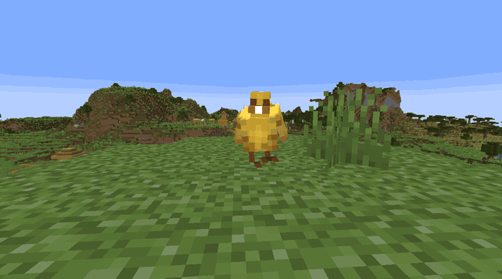

[](https://github.com/Rvhoyos/QuackedMod/releases)

[](https://www.curseforge.com/minecraft/mc-mods/ducky-quack-pack)
[](https://modrinth.com/mod/ducky-quack-pack)
[](#license)


---

# Ducky Quack Pack 2.0

Ducks for Minecraft, on Fabric and NeoForge.

Get it on [CurseForge](https://www.curseforge.com/minecraft/mc-mods/ducky-quack-pack) or
[Modrinth](https://modrinth.com/mod/ducky-quack-pack).

## New in 2.0

Ducks fly. Untamed leaders take their flock to new ground every few minutes, and adults escape into
the air when something hits them.

## Ducks

- A flock walks single file behind its leader. The leader has a particle crown.
- Feed the leader seeds to tame it. The wild followers keep trailing it, and it follows you.
- Tamed ducks do not flee predators and do not migrate.
- Ducklings follow the nearest adult.
- They spawn in temperate, forest, taiga, wetland, river and shore biomes, more often near water.

## Items

Duck meat, feathers, eggs, arrows and foie gras. Recipes are on the
[wiki](https://quackedmod.wiki/wiki/items).

## Config

`/quack config` in game, with cheats on. Or edit `config/quack.json` and run `/quack reload`.

Duck settings apply to every loaded duck straight away. Spawn settings are read at world load, so
they need a restart.

## Compatibility

| | Version |
|--|--|
| Minecraft | 26.2 |
| Fabric Loader | 0.19.3+ |
| Fabric API | Required |
| NeoForge | 26.2.x |
| GeckoLib | 5.5.3 or any later 5.x, required on both loaders |
| Java | 25 |

## Install

Use CurseForge or Modrinth, or drop the jars into `mods/` yourself:

- Fabric: `fabric-api (26.2).jar`, `geckolib-fabric-5.5.3.jar`, `quack-fabric-2.0.5.jar`
- NeoForge: `geckolib-neoforge-5.5.3.jar`, `quack-neoforge-2.0.5.jar`

Servers are the same. Config generates at `config/quack.json` on first start.
GeckoLib is at [modrinth.com/mod/geckolib](https://modrinth.com/mod/geckolib/versions?g=26.2).

## Building

Needs JDK 25.

```bash
./gradlew :fabric:build
./gradlew :neoforge:build
```

JARs land in `fabric/build/libs/` and `neoforge/build/libs/`.

## Credits

Model assets and animations are thanks to callout662.

## License

All Rights Reserved. You may not redistribute, modify, or use this mod's assets or source code
without explicit permission.
